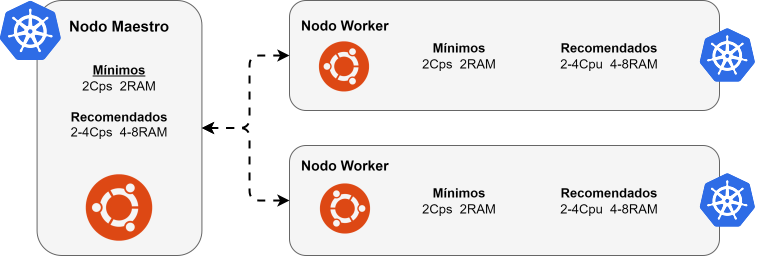

# Instalación de Kubernetes

La instalación de Kubernetes en un cluster de nodos puede ser un proceso complejo la primera vez, pero no nos preocupemos. En esta guía agruparé distintos tutoriales de instalación con distintos motores de contenedores y distintos sistemas operativos. El proceso está muy mascado y probado, pero si tenemos algún problema, no dudemos en abrir un issue en el [repositorio de Github](https://github.com/pabpereza/pabpereza/issues).

Para todas las instalaciones, estos son los requisitos mínimos y los recomendados para un cluster de Kubernetes:




🎥 Vídeo completo, utilicemos los capítulos de youtube para saltar a la sección que nos interese:
[https://youtu.be/ZS0isVTIVyI](https://youtu.be/ZS0isVTIVyI)

[](https://www.youtube.com/watch?v=ZS0isVTIVyI)

> **Nota sobre versiones**: en los ejemplos usamos Kubernetes v1.34 (la que usamos en el último curso presencial, octubre de 2026). Podemos instalar otra versión cambiando el número en las URLs del repositorio y en los paquetes. Los repositorios antiguos (`apt.kubernetes.io` y `packages.cloud.google.com`) fueron retirados en 2024; usemos siempre los repositorios comunitarios `pkgs.k8s.io` como se muestra a continuación.

## Ubuntu Server 24.04 con Containerd

### Nodo maestro
**NOTA:** Hasta el paso 11 todos los comandos se ejecutan con el usuario root. A partir de ese paso, se ejecutarán con el usuario normal que se haya creado en el sistema, en mi caso `pabpereza`.

1. Actualizar paquetería e instalar requisitos previos:
```bash
apt update && apt upgrade -y

apt install curl apt-transport-https git wget software-properties-common lsb-release ca-certificates socat -y
```

2. Desactivar swap (el kubelet, por defecto, no arranca con la swap activa):
```bash
swapoff -a
sed -i '/swap/s/^\(.*\)$/#\1/g' /etc/fstab # Auto comenta la línea de swap en fstab
```

3. Cargar los módulos necesarios del kernel y añadir la configuración de sysctl:
```bash
modprobe overlay
modprobe br_netfilter

cat << EOF | tee /etc/sysctl.d/kubernetes.conf
net.bridge.bridge-nf-call-ip6tables = 1
net.bridge.bridge-nf-call-iptables = 1
net.ipv4.ip_forward = 1
EOF
```

4. Aplicar la configuración de sysctl y comprobar que se ha aplicado correctamente:
```bash
sysctl --system
```

5. Instalar las claves gpg de Docker para poder instalar containerd:
```bash
mkdir -p /etc/apt/keyrings

curl -fsSL https://download.docker.com/linux/ubuntu/gpg \
| sudo gpg --dearmor -o /etc/apt/keyrings/docker.gpg

echo \
"deb [arch=$(dpkg --print-architecture) signed-by=/etc/apt/keyrings/docker.gpg] \
https://download.docker.com/linux/ubuntu \
$(lsb_release -cs) stable" | sudo tee /etc/apt/sources.list.d/docker.list > /dev/null
```

6. Instalar containerd y configurar el daemon para que use cgroups de systemd:
```bash
apt update && apt install containerd.io -y

containerd config default | tee /etc/containerd/config.toml

sed -e's/SystemdCgroup = false/SystemdCgroup = true/g' -i /etc/containerd/config.toml

systemctl restart containerd
```

Comprobemos que el cambio está hecho, porque es el paso que más se olvida:
```bash
grep SystemdCgroup /etc/containerd/config.toml   # debe decir: SystemdCgroup = true
```

> **No nos saltemos este paso en ningún nodo.** El paquete `containerd.io` trae un `config.toml` que **desactiva el plugin CRI**, el que usa Kubernetes. Con ese fichero, `kubeadm init` o `kubeadm join` fallan en las comprobaciones previas con un error que contiene `validate CRI v1 runtime API`. Regenerar la configuración por defecto y activar `SystemdCgroup` lo arregla.

7. Instalar las claves gpg de Kubernetes:
```bash
mkdir -p -m 755 /etc/apt/keyrings

curl -fsSL https://pkgs.k8s.io/core:/stable:/v1.34/deb/Release.key \
| sudo gpg --dearmor -o /etc/apt/keyrings/kubernetes-apt-keyring.gpg
```

8. Añadir el repositorio de Kubernetes 1.34 (podemos cambiar la versión modificando las URLs):
```bash
echo "deb [signed-by=/etc/apt/keyrings/kubernetes-apt-keyring.gpg] \
https://pkgs.k8s.io/core:/stable:/v1.34/deb/ /" \
| sudo tee /etc/apt/sources.list.d/kubernetes.list

apt update
```

9. Instalar kubeadm, kubelet y kubectl:
```bash
apt install -y kubeadm=1.34.12-1.1 kubelet=1.34.12-1.1 kubectl=1.34.12-1.1 cri-tools

apt-mark hold kubelet kubeadm kubectl # Bloquear actualizaciones automáticas
```

Podemos consultar las versiones exactas disponibles en el repositorio con `apt-cache madison kubeadm`.

`cri-tools` trae **`crictl`**, el equivalente a `docker ps` para los contenedores que gestiona el kubelet. Le decimos dónde está el socket de containerd para que no lo vaya buscando (y avisando) por otros runtimes:
```bash
cat << EOF | tee /etc/crictl.yaml
runtime-endpoint: unix:///run/containerd/containerd.sock
image-endpoint: unix:///run/containerd/containerd.sock
EOF

crictl ps   # contenedores en marcha en este nodo
```

10. Buscamos nuestra IP y la añadimos al fichero `/etc/hosts` con el nombre del nodo maestro (en mi caso `k8scp`, de control plane, pero podemos darle el nombre que prefiramos):
```bash
echo "<IP> k8scp" >> /etc/hosts
```

Podemos obtener nuestra IP con el comando `ip a`, `ip addr show` o `hostname -i`.

11. Iniciar el cluster con kubeadm. Importante: elijamos un rango de IPs para los pods que **no se solape** con la red de nuestras máquinas ni con otros rangos en uso (de lo contrario tendremos problemas de enrutado difíciles de diagnosticar). Por último, añadimos el nombre del nodo maestro (recordemos usar el del paso anterior) y el puerto 6443:
```bash
kubeadm init --pod-network-cidr=<rango de IPs para pods> --control-plane-endpoint=<nombre añadido en el /etc/hosts>:6443

# Por ejemplo:
# kubeadm init --pod-network-cidr=192.168.0.0/16 --control-plane-endpoint=k8scp:6443
```

Si vamos a conectarnos al API server desde fuera (por ejemplo, con un túnel SSH a `127.0.0.1` o por la IP pública de una VM en la nube), añadamos esos nombres al certificado con `--apiserver-cert-extra-sans`. Si no, `kubectl`, Headlamp o Freelens se quejarán de que el certificado no es válido para esa dirección:
```bash
kubeadm init \
  --pod-network-cidr=192.168.0.0/16 \
  --control-plane-endpoint=k8scp:6443 \
  --apiserver-cert-extra-sans=127.0.0.1,<ip-publica>
```

Guardemos la salida del comando: incluye el `kubeadm join` que usaremos después para unir los nodos worker.

12. Configurar kubectl e instalar el autocompletado (desde aquí, con nuestro usuario normal):
```bash
mkdir -p $HOME/.kube

sudo cp -i /etc/kubernetes/admin.conf $HOME/.kube/config

sudo chown $(id -u):$(id -g) $HOME/.kube/config

sudo apt install bash-completion -y

source <(kubectl completion bash)

echo 'source <(kubectl completion bash)' >> ~/.bashrc # persistir autocompletado
```

Esto nos permitirá usar el autocompletado en la terminal de bash: si pulsamos tabulador después de escribir `kubectl`, nos mostrará las opciones disponibles.


13. Instalar Helm, necesario para instalar algunas aplicaciones en Kubernetes, incluido Cilium (la CNI que vamos a instalar):
```bash
curl -fsSL https://packages.buildkite.com/helm-linux/helm-debian/gpgkey | gpg --dearmor | sudo tee /usr/share/keyrings/helm.gpg > /dev/null

echo "deb [signed-by=/usr/share/keyrings/helm.gpg] https://packages.buildkite.com/helm-linux/helm-debian/any/ any main" | sudo tee /etc/apt/sources.list.d/helm-stable-debian.list

sudo apt update

sudo apt install helm -y
```

14. Instalar Cilium, una CNI (Container Network Interface) que permitirá comunicar los pods entre sí:
```bash
helm repo add cilium https://helm.cilium.io/

helm repo update

helm template cilium cilium/cilium --version 1.17.4 \
--namespace kube-system \
--set ipam.mode=kubernetes > cilium.yaml

kubectl apply -f cilium.yaml
```

> **Por qué `ipam.mode=kubernetes`:** sin esta opción, Cilium usa su modo por defecto (`cluster-pool`), que reparte las IPs de los pods desde `10.0.0.0/8` e **ignora** el `--pod-network-cidr` del `kubeadm init`. Si nuestras máquinas están en una red `10.x` (lo habitual en Azure, AWS o en muchas oficinas), el nodo recibe un rango de pods que contiene su propia red. En el curso presencial al control plane le tocó `10.0.0.0/24`, justo la red de las VMs: su ruta hacia Cilium se tragaba el tráfico hacia los workers y estos se quedaban en `NotReady`. Con `ipam.mode=kubernetes`, Cilium usa el rango de kubeadm, un `/24` por nodo.

Comprobemos que Cilium está sano y que cada nodo tiene su trozo del rango de pods:
```bash
kubectl -n kube-system exec ds/cilium -c cilium-agent -- cilium status --brief
kubectl get nodes -o custom-columns=NODO:.metadata.name,PODCIDR:.spec.podCIDR
```

```text
OK
NODO           PODCIDR
vmsbxk8s0001   192.168.0.0/24
vmsbxk8s0003   192.168.1.0/24
vmsbxk8s0004   192.168.2.0/24
```

Cilium encapsula el tráfico entre nodos en **VXLAN** (puerto UDP 8472), así que no necesita tocar el enrutado de la red de las máquinas.

15. (Opcional y no recomendado) Si queremos que nuestro nodo maestro también ejecute pods como si fuera un worker (útil en laboratorios con un solo nodo), eliminemos su taint:
```bash
kubectl taint nodes --all node-role.kubernetes.io/control-plane-
```

Podríamos reactivar la restricción (taint) para que el nodo maestro no ejecute pods con el comando:
```bash
kubectl taint nodes --all node-role.kubernetes.io/control-plane:NoSchedule
```

> En versiones antiguas de Kubernetes (anteriores a la 1.24) existía también el taint `node-role.kubernetes.io/master`, hoy eliminado en favor de `control-plane`.

### Nodo worker
Esta parte de la instalación la haremos sobre el servidor que queramos añadir al cluster. En este caso, el nodo worker.

1. Repetir los pasos 1 a 10 del nodo maestro. **IMPORTANTE:** en el fichero `/etc/hosts` debemos añadir la IP y el nombre **del nodo maestro**, exactamente igual que hicimos en él. No lo adaptemos a este nodo.

   Prestemos especial atención al **paso 6** (configuración de containerd): en los workers es el que más se olvida, porque el clúster "ya funciona" en el maestro. Antes de unir el nodo:
```bash
grep SystemdCgroup /etc/containerd/config.toml   # SystemdCgroup = true
crictl info > /dev/null && echo "CRI OK"
```

2. Unir el nodo worker al cluster con el comando que nos proporcionó `kubeadm init` en el nodo maestro:
```bash
kubeadm join <nombre del nodo maestro>:6443 --token <token> --discovery-token-ca-cert-hash sha256:<hash>
```

Si el `join` falla a medias (por ejemplo, con el error `validate CRI v1 runtime API` porque containerd no estaba bien configurado), arreglemos la causa y **limpiemos el nodo antes de reintentar**. Si no, el siguiente `join` tropezará con los ficheros que dejó el intento anterior:
```bash
kubeadm reset -f
rm -rf /etc/cni/net.d/*
kubeadm join ...   # el mismo comando de antes
```

El token se puede obtener con el comando `kubeadm token list` lanzado en el nodo maestro. Si hubiera expirado (dura 24 horas), se puede generar uno nuevo con `kubeadm token create`. De hecho, `kubeadm token create --print-join-command` nos genera el comando de unión completo, con token y hash incluidos.

El hash también se puede obtener manualmente con el siguiente comando de openssl, lanzado en el nodo maestro:
```bash
openssl x509 -pubkey -in /etc/kubernetes/pki/ca.crt | openssl rsa -pubin -outform der 2>/dev/null | openssl dgst -sha256 -hex | sed 's/^.* //'
```

3. Comprobar que el nodo worker se ha unido correctamente al cluster. Lancemos el siguiente comando en el nodo maestro (es posible que tarde un poco en aparecer como `Ready`):
```bash
kubectl get nodes
```

## Ubuntu Server 20.04 y 22.04 con Containerd
El proceso es prácticamente idéntico al de Ubuntu 24.04. La única diferencia reseñable es que, en esta variante, usaremos Calico como CNI en lugar de Cilium.

> **ATENCIÓN:** si venimos de tutoriales antiguos, los repositorios `apt.kubernetes.io` y `packages.cloud.google.com` ya no existen. Usemos los repositorios `pkgs.k8s.io` como se indica en los pasos 7 y 8 de la sección anterior.

### Nodo maestro
1. Instalar requisitos previos:
```bash
apt install curl apt-transport-https vim git wget gnupg2 \
software-properties-common ca-certificates uidmap -y
```

2. Desactivar swap:
```bash
swapoff -a
sed -i '/swap/s/^\(.*\)$/#\1/g' /etc/fstab # Auto comenta la línea de swap en fstab
```

3. Cargar los módulos necesarios y hacerlos persistentes:
```bash
modprobe overlay
modprobe br_netfilter

sudo tee /etc/modules-load.d/k8s.conf <<EOF
overlay
br_netfilter
EOF
```


4. Configurar sysctl:
```bash
cat << EOF | tee /etc/sysctl.d/kubernetes.conf
net.bridge.bridge-nf-call-ip6tables = 1
net.bridge.bridge-nf-call-iptables = 1
net.ipv4.ip_forward = 1
EOF

sysctl --system # Aplica la configuración
```

5. Añadir al fichero `/etc/hosts` la IP y el nombre de la máquina (ATENCIÓN: pongamos la IP del nodo maestro si estamos configurando un worker). Con esto podremos configurar el cluster usando el nombre de la máquina en vez de la IP:
```bash
echo "<IP> <NOMBRE>" >> /etc/hosts
```

6. Instalar containerd (mismos pasos 5 y 6 de la sección de Ubuntu 24.04):
```bash
mkdir -p /etc/apt/keyrings

curl -fsSL https://download.docker.com/linux/ubuntu/gpg \
| sudo gpg --dearmor -o /etc/apt/keyrings/docker.gpg

echo \
"deb [arch=$(dpkg --print-architecture) signed-by=/etc/apt/keyrings/docker.gpg] \
https://download.docker.com/linux/ubuntu \
$(lsb_release -cs) stable" | sudo tee /etc/apt/sources.list.d/docker.list > /dev/null

apt update && apt install containerd.io -y
```

7. Configurar containerd para que use cgroups de systemd:
```bash
mkdir -p /etc/containerd
containerd config default | sudo tee /etc/containerd/config.toml

sed -e's/SystemdCgroup = false/SystemdCgroup = true/g' -i /etc/containerd/config.toml
```

8. Iniciar containerd:
```bash
systemctl enable containerd
systemctl restart containerd
```

9. Instalar kubeadm, kubelet y kubectl desde los repositorios `pkgs.k8s.io`:
```bash
# Añadir clave y repositorio de Kubernetes
mkdir -p -m 755 /etc/apt/keyrings

curl -fsSL https://pkgs.k8s.io/core:/stable:/v1.34/deb/Release.key \
| sudo gpg --dearmor -o /etc/apt/keyrings/kubernetes-apt-keyring.gpg

echo "deb [signed-by=/etc/apt/keyrings/kubernetes-apt-keyring.gpg] \
https://pkgs.k8s.io/core:/stable:/v1.34/deb/ /" \
| sudo tee /etc/apt/sources.list.d/kubernetes.list

# Instalar paquetes
apt update && apt install -y kubelet kubeadm kubectl
# Especificar versión concreta, por ejemplo:
#apt install -y kubelet=1.34.12-1.1 kubeadm=1.34.12-1.1 kubectl=1.34.12-1.1

# Bloquear actualizaciones automáticas
apt-mark hold kubelet kubeadm kubectl

# Iniciar kubelet
systemctl enable kubelet
```


10. Iniciar el cluster en el nodo maestro:
```bash
kubeadm init --pod-network-cidr=<rango de IPs para pods> --control-plane-endpoint=<nombre añadido en /etc/hosts>:6443
```

11. Configurar kubectl:
```bash
mkdir -p $HOME/.kube
cp -i /etc/kubernetes/admin.conf $HOME/.kube/config
chown $(id -u):$(id -g) $HOME/.kube/config
```

12. Instalar la red de pods:
Este paso es importante: tendremos que editar el archivo de configuración de la red de pods para que funcione correctamente. En este caso usaremos Calico, pero podemos usar cualquier otra CNI. Debemos especificar en la variable `CALICO_IPV4POOL_CIDR` el mismo rango de IPs que usamos en el paso 10:
```bash
wget https://raw.githubusercontent.com/projectcalico/calico/v3.29.1/manifests/calico.yaml

# Editar el archivo de configuración de Calico descomentando las líneas. Quedando así:
- name: CALICO_IPV4POOL_CIDR
  value: "rango de IPs para pods"
```

Por ejemplo:
```yaml
            # The default IPv4 pool to create on startup if none exists. Pod IPs will be
            # chosen from this range. Changing this value after installation will have
            # no effect. This should fall within `--cluster-cidr`.
            - name: CALICO_IPV4POOL_CIDR
              value: "192.168.0.0/16"
```

13. Aplicar la red de pods:
```bash
kubectl apply -f calico.yaml
```


### Nodo worker
Repetimos los pasos 1 a 9 del nodo maestro. Esta vez, en el fichero `/etc/hosts` tenemos que añadir la IP y el nombre del **nodo maestro**.

1. Unir el worker al cluster:
```bash
kubeadm join <nombre del nodo maestro>:6443 --token <token> --discovery-token-ca-cert-hash sha256:<hash>
```

El token se puede obtener con el comando `kubeadm token list` lanzado en el nodo maestro. Si hubiera expirado, se puede generar uno nuevo con `kubeadm token create`. Recordemos que `kubeadm token create --print-join-command` nos da el comando completo.

El hash se puede obtener con el siguiente comando de openssl, lanzado en el nodo maestro:
```bash
openssl x509 -pubkey -in /etc/kubernetes/pki/ca.crt | openssl rsa -pubin -outform der 2>/dev/null | openssl dgst -sha256 -hex | sed 's/^.* //'
```


---
* Lista de vídeos en Youtube: [Curso Kubernetes](https://www.youtube.com/playlist?list=PLQhxXeq1oc2k9MFcKxqXy5GV4yy7wqSma)

[Volver al índice](README.md#índice)
