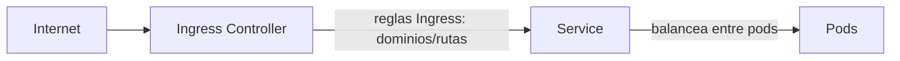
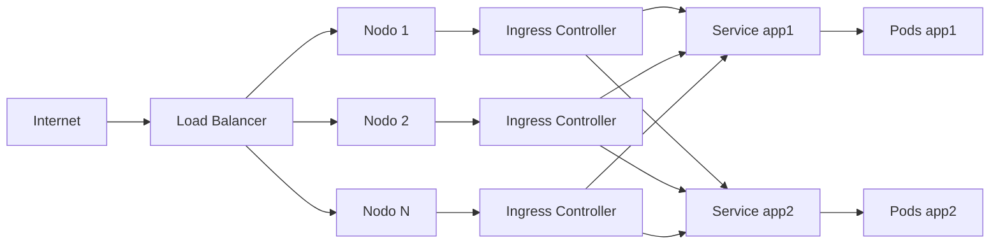

# Ingress en Kubernetes

En Kubernetes, exponer aplicaciones al exterior puede hacerse de varias formas. Los **Services** permiten exponer pods dentro o fuera del clúster, pero si necesitamos enrutar tráfico HTTP/HTTPS externo a diferentes servicios internos según el dominio o la ruta, necesitamos un recurso adicional: **Ingress**.

Podemos repasar la parte de [Services](./110.Services.md) para refrescar conceptos.

> **Aviso:** el controlador `ingress-nginx` (el del proyecto Kubernetes que usamos en este capítulo) está **retirado**. Su mantenimiento terminó en marzo de 2026: ya no recibe nuevas versiones, ni correcciones, ni parches de seguridad. Las instalaciones existentes siguen funcionando, pero para clústeres nuevos la recomendación oficial es pasar a **Gateway API**, que vemos en el [siguiente capítulo](./112.Gateway.md). Aun así, el recurso `Ingress` sigue siendo parte de Kubernetes (y del temario de las certificaciones), así que merece la pena entenderlo. Más detalles en el [anuncio oficial](https://kubernetes.io/blog/2025/11/11/ingress-nginx-retirement/).

🎥 Vídeo completo, utilicemos los capítulos de youtube para saltar a la sección que nos interese:
[https://youtu.be/U87QO6VxReA](https://youtu.be/U87QO6VxReA)

[](https://www.youtube.com/watch?v=U87QO6VxReA)

## ¿Cómo se relacionan Service, Ingress e Ingress Controller?

- **Service**: expone y balancea el acceso a los pods. Puede ser interno (ClusterIP) o externo (NodePort, LoadBalancer).
- **Ingress**: define reglas de enrutamiento HTTP/HTTPS para exponer uno o varios servicios internos bajo una única IP/punto de entrada, gestionando rutas y dominios.
- **Ingress Controller**: es el componente (normalmente un pod) que observa los objetos Ingress y aplica las reglas, actuando como proxy inverso (por ejemplo, nginx).

### Diagrama visual del flujo de tráfico



- El tráfico externo llega al **Ingress Controller**.
- El **Ingress** define a qué **Service** debe enviarse cada petición según la ruta o dominio.
- El **Service** balancea el tráfico entre los pods correspondientes.

De este modo, podemos tener múltiples aplicaciones (web, API, etc.) expuestas bajo diferentes rutas o dominios, todas gestionadas de forma centralizada y segura.

Cualquier tecnología que sirviera como proxy inverso se puede utilizar como `ingress controller`. Uno de los más comunes es nginx.

[Ejemplos de configuración de nginx para diferentes plataformas ( docker desktop, minikube, AWS, GCP, Azure...)](https://github.com/kubernetes/ingress-nginx/blob/main/docs/deploy/index.md)

## Instalación de un ingress controller
Podemos instalar el ingress controller basado en nginx con [Helm](./124.Helm.md).

Documentación oficial: [ingress-nginx](https://kubernetes.github.io/ingress-nginx/deploy/)

Primero, añadimos el repositorio de charts de nginx ingress:
``` bash
helm repo add ingress-nginx https://kubernetes.github.io/ingress-nginx
helm repo update
```

Seguidamente, ejecutamos el siguiente comando para instalar el ingress controller de nginx. Fijemos siempre la versión del chart con `--version`: así la instalación es repetible y no cambia el día que salga una nueva:
``` bash 
helm install ingress-nginx ingress-nginx/ingress-nginx \
  --version 4.15.1 \
  --namespace ingress-nginx \
  --create-namespace \
  --set controller.service.type=NodePort \
  --set controller.ingressClassResource.name=nginx
```

Llamar a la release `ingress-nginx` no es un capricho: el chart compone el nombre de sus recursos a partir de ella, y así el Service y el DaemonSet o Deployment se llaman `ingress-nginx-controller`, que es como aparecen en la documentación y en casi todos los tutoriales.

Comprobemos que existe la clase que usarán nuestros Ingress:
```bash
kubectl get ingressclass
```

```text
NAME    CONTROLLER             PARAMETERS   AGE
nginx   k8s.io/ingress-nginx   <none>       1m
```

Ahora ya podemos añadir objetos de tipo `ingress` en Kubernetes.

### Variante: una sola IP pública y sin balanceador

En el curso presencial montamos el clúster en VMs de Azure donde **solo el control plane tenía IP pública** y no había balanceador delante. Un NodePort obligaría a usar puertos raros (30000-32767), así que lo instalamos de otra forma:

```bash
CP_IP=$(kubectl get node -l node-role.kubernetes.io/control-plane \
  -o jsonpath='{.items[0].status.addresses[?(@.type=="InternalIP")].address}')

helm install ingress-nginx ingress-nginx/ingress-nginx \
  --version 4.15.1 \
  --namespace ingress-nginx --create-namespace \
  --set controller.kind=DaemonSet \
  --set controller.service.type=ClusterIP \
  --set "controller.service.externalIPs={$CP_IP}"
```

| Opción | Para qué |
|---|---|
| `controller.kind=DaemonSet` | Un controlador en cada worker. El control plane no ejecuta ninguno, por su taint |
| `controller.service.type=ClusterIP` | Sin puertos aleatorios de NodePort |
| `controller.service.externalIPs` | Lo que llega al 80 y al 443 de la IP **privada** del control plane va a los controladores |

En el control plane no hay ningún proceso escuchando en el 80: son reglas de kube-proxy, que corre en todos los nodos y reenvía ese tráfico a los controladores de los workers. El Service lo refleja en `EXTERNAL-IP`:

```bash
kubectl -n ingress-nginx get service ingress-nginx-controller
```

```text
NAME                       TYPE        CLUSTER-IP     EXTERNAL-IP   PORT(S)
ingress-nginx-controller   ClusterIP   10.x.x.x       10.x.0.4      80/TCP,443/TCP
```

> **Ojo con `hostPort`:** muchos tutoriales abren el 80/443 del nodo con `hostPort`. Con **Cilium sin sustituir a kube-proxy** (la instalación del [capítulo 3](./103.Instalacion.md)) **no funciona**: Cilium no gestiona los `hostPort` en ese modo, y el puerto nunca llega a abrirse. Por eso usamos `externalIPs`.

## Deployments para el caso práctico 
Para este ejemplo, vamos a crear dos deployments de ejemplo, `app1` y `app2`, que simulan aplicaciones web. Estos deployments expondrán un servicio en el puerto 8080.
```yaml
apiVersion: apps/v1
kind: Deployment
metadata:
  name: app1
  labels:
    app: app1
spec:
  replicas: 3
  selector:
    matchLabels:
      app: app1
  template:
    metadata:
      labels:
        app: app1
    spec:
      containers:
      - name: nginx
        image: nginx
        ports:
        - containerPort: 80
        command: ["/bin/sh", "-c"]
        args:
          - |
            echo '¡Soy la primera, la aplicación numero 1!' > /usr/share/nginx/html/index.html && \
            nginx -g 'daemon off;'
---
apiVersion: v1
kind: Service
metadata:
  name: servicio-app1
spec:
  selector:
    app: app1
  ports:
    - port: 8080
      targetPort: 80
  type: ClusterIP
```

Para la app2, solo hemos modificado el mensaje que se muestra en la página web y el 'app1' por 'app2':
```yaml
apiVersion: apps/v1
kind: Deployment
metadata:
  name: app2
  labels:
    app: app2
spec:
  replicas: 3
  selector:
    matchLabels:
      app: app2
  template:
    metadata:
      labels:
        app: app2
    spec:
      containers:
      - name: nginx
        image: nginx
        ports:
        - containerPort: 80
        command: ["/bin/sh", "-c"]
        args:
          - |
            echo '¡Soy la segunda, la aplicación numero 2!' > /usr/share/nginx/html/index.html && \
            nginx -g 'daemon off;'
---
apiVersion: v1
kind: Service
metadata:
  name: servicio-app2
spec:
  selector:
    app: app2
  ports:
    - port: 8080
      targetPort: 80
  type: ClusterIP
```

Una vez que tenemos el laboratorio listo, podemos ver cómo funcionan los ingress.

Podemos declarar el objeto ingress de Kubernetes como en el siguiente ejemplo:
``` yaml 
apiVersion: networking.k8s.io/v1
kind: Ingress
metadata:
  name: minimal-ingress
  annotations:
    nginx.ingress.kubernetes.io/rewrite-target: /
spec:
  rules:
  - http:
      paths:
      - path: /testpath
        pathType: Prefix
        backend:
          service:
            name: test
            port:
              number: 80

```

Este es muy básico, y simplemente redirige el tráfico que llega a la ruta `/testpath` al servicio `test` en el puerto 80.

> **Cuidado, a este ejemplo le falta `ingressClassName`.** Si en el clúster no hay una IngressClass marcada como predeterminada, el controlador **ignora** el Ingress: se crea sin errores, pero todas las peticiones devuelven 404. Lo delata el log del controlador (`kubectl -n ingress-nginx logs ds/ingress-nginx-controller`, o `deploy/` si no es un DaemonSet), con un mensaje como `Ignoring ingress because of error while validating ingress class ... ingress does not contain a valid IngressClass`. En el resto de ejemplos lo indicamos siempre con `ingressClassName: nginx`.

Tenemos múltiples formas de definir un `ingress`, dependiendo de nuestras necesidades.

Lo más común es diferenciar el tráfico entrante por la ruta de la petición o por el host de la petición. Vamos a ver ejemplos de ambos casos.


## Ingress por path

```yaml
apiVersion: networking.k8s.io/v1
kind: Ingress
metadata:
  name: minimal-ingress
  annotations:
    nginx.ingress.kubernetes.io/rewrite-target: /
spec:
  ingressClassName: nginx
  rules:
  - http:
      paths:
      - path: /app1
        pathType: Prefix
        backend:
          service:
            name: servicio-app1
            port:
              number: 8080
      - path: /app2
        pathType: Prefix
        backend:
          service:
            name: servicio-app2
            port:
              number: 8080
```

## Ingress por host
Aunque lo más común es diferenciar por el host de la petición, es decir, por el nombre de dominio. En este caso, el manifiesto sería algo así:
```yaml
apiVersion: networking.k8s.io/v1
kind: Ingress
metadata:
  name: host-ingress
spec:
  ingressClassName: nginx
  rules:
  - host: app1.example.com
    http:
      paths:
      - path: /
        pathType: Prefix
        backend:
          service:
            name: servicio-app1
            port:
              number: 8080
  - host: app2.example.com
    http:
      paths:
      - path: /
        pathType: Prefix
        backend:
          service:
            name: servicio-app2
            port:
              number: 8080
```


## Creación de un ingress con TLS y varias rutas
Veamos ahora un ejemplo más completo de un objeto `ingress` que expone las aplicaciones `app1` y `app2` bajo diferentes dominios, con soporte para TLS y múltiples rutas. El manifiesto podría ser algo así:

```yaml
apiVersion: networking.k8s.io/v1
kind: Ingress
metadata:
  name: multi-app-ingress
spec:
  ingressClassName: nginx
  tls:
  - hosts:
    - app1.example.com
    - app2.example.com
    secretName: example-tls-secret
  rules:
  - host: app1.example.com
    http:
      paths:
      - path: /
        pathType: Prefix
        backend:
          service:
            name: servicio-app1
            port:
              number: 8080
  - host: app2.example.com
    http:
      paths:
      - path: /
        pathType: Prefix
        backend:
          service:
            name: servicio-app2
            port:
              number: 8080
```

Podemos ver que hemos añadido una sección `tls` que especifica los hosts y el secreto que contiene el certificado TLS. Esto permite que las peticiones a `app1.example.com` y `app2.example.com` se sirvan de forma segura a través de HTTPS.

Si hacemos un curl a `https://app1.example.com` o `https://app2.example.com`, el tráfico se cifrará utilizando el certificado especificado en el secreto `example-tls-secret`.

Como no lo hemos creado aún, el ingress controller usará su certificado por defecto, que no es válido, y nos dará un error de certificado, aunque el tráfico se cifrará igualmente.

Veremos cómo crear este secreto más adelante, en la sección de [secretos y configmaps](114.Secrets_configmaps.md).

De momento, como solo podemos generar certificados autofirmados, no podremos acceder a las aplicaciones desde un navegador, ya que este no confiará en el certificado autofirmado. Sin embargo, podemos probarlo con `curl` usando la opción `-k` para ignorar los errores de certificado y depurar el tráfico HTTPS.
```bash
curl -k https://app1.example.com
```

### La redirección a HTTPS afecta a todo el Ingress

En cuanto un Ingress tiene sección `tls`, ingress-nginx **redirige el HTTP a HTTPS** con un `308`:

```text
HTTP/1.1 308 Permanent Redirect
Location: https://app1.<ip>.nip.io
```

Lo que no es tan obvio: la redirección se aplica a **todos los hosts de ese Ingress**, aunque no estén en `tls.hosts`. En el laboratorio del curso, con `app1` en `tls` y `app2` fuera, `app2` también pasó a HTTPS, servido con el certificado genérico del controlador:

```text
*  subject: O=Acme Co; CN=Kubernetes Ingress Controller Fake Certificate
```

Si queremos que un host siga en HTTP, lo ponemos en **otro Ingress** sin sección `tls`.


## Gestión de objetos ingress
Y como con todos los objetos de Kubernetes, los principales comandos de gestión son:
``` bash
kubectl get ingress
kubectl delete ingress <nombre>
kubectl edit ingress <nombre>
```
Nos permiten listar, eliminar o editar los objetos `ingress` respectivamente.

## ¿Y cómo se productiviza esto?
Nos preguntaremos: entonces, ¿tenemos que llamar a los puertos de los nodos directamente? ¿Y si tenemos varios nodos? ¿Y si tenemos varios ingress controllers?

Lo habitual en entornos on-prem es tener un balanceador de carga que se encargue de distribuir el tráfico entre los nodos del clúster (en la nube también existe, solo que lo gestiona el proveedor).

Recordemos que hemos abierto un NodePort en cada uno de los nodos que redirige el tráfico al ingress controller, este a los correspondientes servicios y estos a los pods.
Por lo tanto, el flujo de tráfico sería algo así:



Parece un poco rebuscado, pero esto garantiza balanceo de carga tanto en los pods, como en los nodos, permitiéndonos aumentar el número de nodos y pods según la carga de trabajo sin interrumpir el servicio ni tener que tocar ninguna configuración previa, una maldita pasada.

## Conclusión
En este artículo hemos visto cómo funcionan los Ingress Controllers en Kubernetes, cómo se relacionan con los Services y cómo podemos definir reglas de enrutamiento para exponer nuestras aplicaciones de forma segura y eficiente. Hemos cubierto ejemplos prácticos de configuración, incluyendo el uso de TLS para cifrar el tráfico.

Nos vemos en el siguiente.

---
* Lista de vídeos en Youtube: [Curso Kubernetes](https://www.youtube.com/playlist?list=PLQhxXeq1oc2k9MFcKxqXy5GV4yy7wqSma)

[Volver al índice](README.md#índice)
