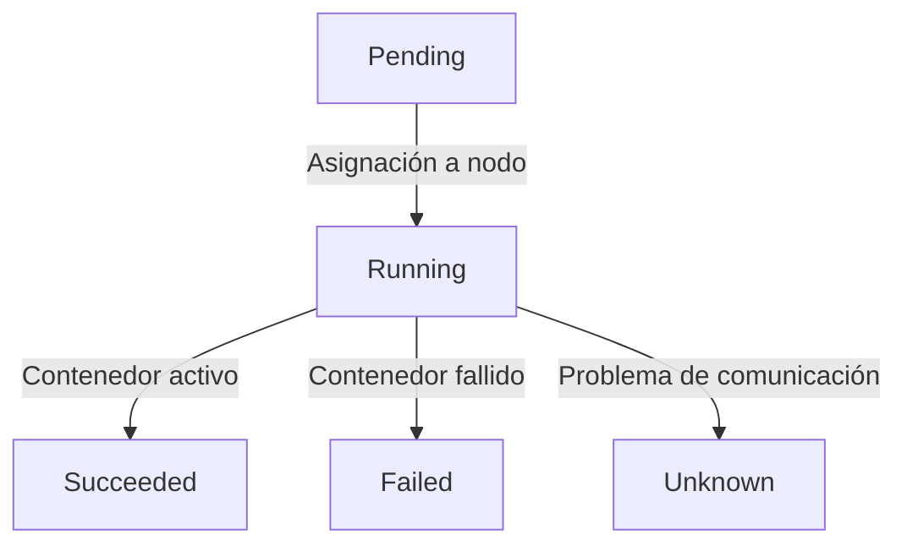
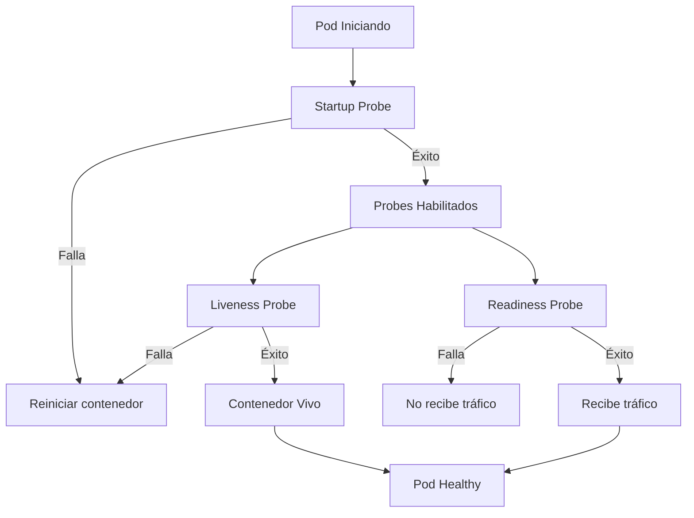

# Probes, liveness y readiness en Kubernetes
Ya hemos visto cómo Kubernetes se encarga de restablecer un servicio o un pod cuando este falla y se reinicia pero, si no especificamos nada, esta auto reparación solo se produce cuando el pod directamente se ha detenido.

Podría pasar que el pod siga funcionando, su proceso o servicio siga activo e incluso sirviendo peticiones, pero que no esté funcionando correctamente. Por ejemplo, un API que responde a las peticiones pero que no está conectado a la base de datos, o por ejemplo, un pod que ha levantado bien el servidor web pero que no ha podido cargar la aplicación que tiene que servir.

Sin pruebas específicas sobre el estado de los pods, es difícil diagnosticar si un pod está funcionando correctamente o no. Para esto, Kubernetes nos ofrece las **Probes**.

Tenemos tres tipos de probes:
- **Liveness Probe**: Comprueba si el contenedor está vivo. Si falla, el kubelet reiniciará el contenedor (no el pod entero).
- **Readiness Probe**: Comprueba si el pod está listo para recibir tráfico. Si falla, Kubernetes dejará de enviarle tráfico hasta que esté listo de nuevo.
- **Startup Probe**: Comprueba si el contenedor ha arrancado correctamente. Si falla, el kubelet reiniciará el contenedor.

🎥 Vídeo completo, utilicemos los capítulos de youtube para saltar a la sección que nos interese:
[https://youtu.be/PCzsfwL0z-Q](https://youtu.be/PCzsfwL0z-Q)

[](https://www.youtube.com/watch?v=PCzsfwL0z-Q)


Antes de ver cómo funcionan, repasemos brevemente el ciclo de vida de un pod en Kubernetes:


## Ciclo de vida de un Pod
Un pod en Kubernetes pasa por varias fases (`status.phase`) a lo largo de su ciclo de vida. Estas fases son:


> Ojo: el `Terminating` o el `CrashLoopBackOff` que vemos en la columna `STATUS` de `kubectl get pods` **no son fases**, son estados que `kubectl` muestra para darnos más contexto. Las fases oficiales son solo las cinco del diagrama.

Aquí hay que sacar en claro que las probes se ejecutan cuando el pod está en fase **Running**, y que si una probe falla el pod **sigue en Running**: o se reinicia el contenedor (liveness y startup) o el pod se marca como **no Ready** y deja de recibir tráfico (readiness). Lo veremos en la columna `READY` de `kubectl get pods` (por ejemplo `0/1`).

Veamos cómo se configuran las probes en un pod en orden de comprobación:


Destacar que la **Startup Probe** se ejecuta al inicio del contenedor, y si falla, el contenedor se reinicia. Una vez que la Startup Probe ha tenido éxito, las otras probes (Liveness y Readiness) se habilitan.

Lo normal es que Readiness y Liveness se ejecuten de forma continua, mientras que Startup solo se ejecuta una vez al inicio del pod. Además, esta última solo se suele utilizar en aplicaciones que tardan mucho en arrancar, como bases de datos o aplicaciones con dependencias pesadas, permitiendo poner comprobaciones de tiempo de espera más largas al principio y luego pasar a las comprobaciones más rápidas de Liveness y Readiness.

## Configuración de Probes
Para configurar las probes, se añaden al contenedor del pod en el archivo de configuración YAML. Vamos a partir del ejemplo de la sección de [Deployments](./107.Deployments.md) y añadir las probes. Como nginx no expone rutas de salud propias, comprobamos la raíz `/`, que siempre responde (si apuntáramos a rutas que no existen, recibiríamos un 404 y el contenedor entraría en un bucle de reinicios):

```yaml
apiVersion: apps/v1
kind: Deployment
metadata:
  name: nginx-deployment
  labels:
    app: nginx
spec:
  replicas: 3
  selector:
    matchLabels:
      app: nginx
  template:
    metadata:
      labels:
        app: nginx
    spec:
      containers:
      - name: nginx
        image: nginx
        ports:
        - containerPort: 80
        startupProbe:
          httpGet:
            path: /
            port: 80
          periodSeconds: 5
          failureThreshold: 30 # Hasta 30 x 5 = 150 segundos para arrancar
        livenessProbe:
          httpGet:
            path: /
            port: 80
          periodSeconds: 10
        readinessProbe:
          httpGet:
            path: /
            port: 80
          periodSeconds: 5
```

En una aplicación propia lo habitual es exponer endpoints dedicados, como `/healthz` para liveness o `/ready` para readiness (que, por ejemplo, compruebe la conexión con la base de datos). Solo hay que usarlos si nuestra aplicación realmente los implementa.

## Tipos de pruebas

- **HTTP Probes** (`httpGet`): Realizan una solicitud HTTP a una ruta específica del contenedor. Si la respuesta es un código de estado HTTP 200-399, se considera exitosa.
- **TCP Probes** (`tcpSocket`): Intenta establecer una conexión TCP al puerto especificado del contenedor. Si la conexión se establece, se considera exitosa.
- **Exec Probes** (`exec`): Ejecuta un comando dentro del contenedor. Si el comando devuelve un código de salida 0, se considera exitosa.
- **gRPC Probes** (`grpc`): Usan el [protocolo estándar de health checking de gRPC](https://grpc.io/docs/guides/health-checking/). Estables desde Kubernetes v1.27; la aplicación debe implementar ese servicio de salud.

Por ejemplo, una liveness probe con `tcpSocket`, otra con `exec` y otra con `grpc` se definirían así:
```yaml
        livenessProbe:
          tcpSocket:
            port: 3306
---
        livenessProbe:
          exec:
            command:
            - cat
            - /tmp/healthy
---
        livenessProbe:
          grpc:
            port: 2379
```

## Atributos de las Probes
Las probes tienen varios atributos que se pueden configurar:
- **initialDelaySeconds**: Tiempo en segundos que Kubernetes espera antes de ejecutar la probe por primera vez después de que el contenedor haya arrancado.
- **periodSeconds**: Intervalo en segundos entre cada ejecución de la probe.
- **timeoutSeconds**: Tiempo en segundos que Kubernetes espera una respuesta antes de considerar que la probe ha fallado.
- **successThreshold**: Número de veces que la probe debe tener éxito antes de considerar que el contenedor está listo o vivo.
- **failureThreshold**: Número de veces que la probe puede fallar antes de que Kubernetes tome una acción (reiniciar el contenedor o marcar el pod como no listo).


---
* Lista de vídeos en Youtube: [Curso Kubernetes](https://www.youtube.com/playlist?list=PLQhxXeq1oc2k9MFcKxqXy5GV4yy7wqSma)

[Volver al índice](README.md#índice)

